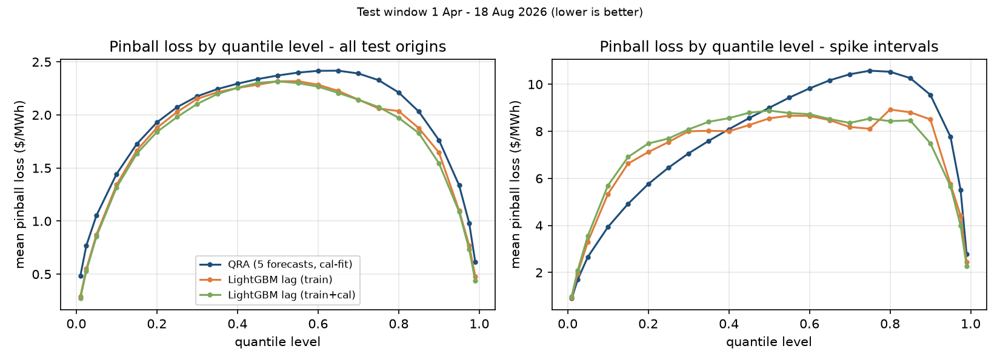
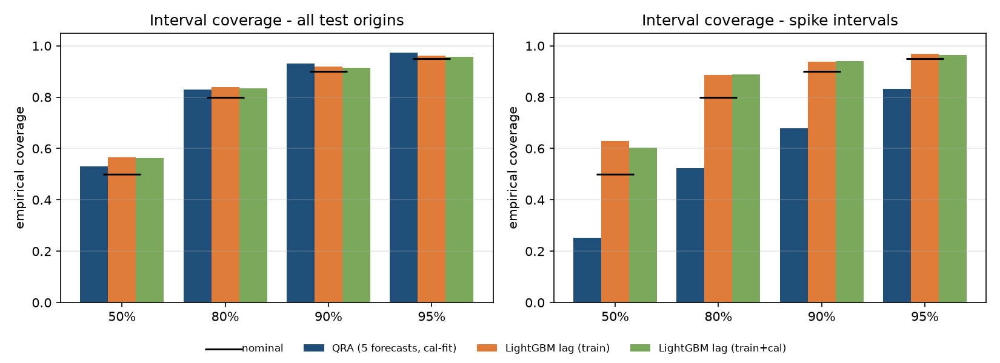
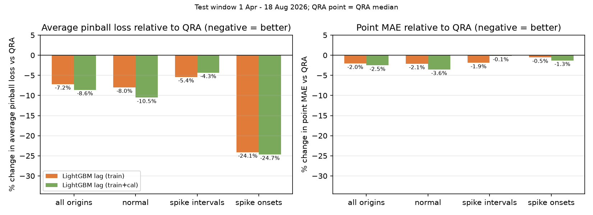

# Forecasting electricity price spikes in Western Australia's wholesale market

**Probabilistic 5-minute price forecasts for the WEM (Wholesale Electricity Market), built to warn about price spikes early enough for batteries, flexible industrial loads and retailers to act.**

Curtin University MATH5001 project. Python, LightGBM, quantile regression, conformal prediction, leakage-tested time-series design.

| Headline (test window 1 Apr – 18 Aug 2026, 40,127 five-minute intervals, never used for fitting or tuning) | |
| --- | --- |
| Gradient-boosted (LightGBM) quantile model vs the QRA benchmark: average pinball loss | **−7.2%** (1.686 vs 1.817 $/MWh) |
| Same, at the **first interval of a price spike** (403 onsets) | **−24.1%** (13.23 vs 17.44) |
| 90% prediction-interval coverage during spike intervals | **0.94** LightGBM vs **0.68** QRA |
| Point-forecast MAE vs naive persistence | 4.65 vs 4.75 $/MWh (−2%, block-bootstrap range below zero) |

Every number in this README comes from a script in this repository and a CSV in `reports/forecast/`. Business-value figures are labelled **illustrative** and show their formula and assumptions.

---

## 1. The problem

The WEM moved to 5-minute dispatch on 1 October 2023. Most of the time the market clearing price (MCP) sits between about $97 and $133/MWh (the test-window interquartile range). Occasionally it jumps above $170/MWh, and in the test window it reached $983.87/MWh. Those spike intervals drive a large share of energy cost and risk for anyone exposed to spot prices:

- a **battery operator** wants to be charged, and to hold charge, just before a spike;
- a **large industrial load** (a mine site, a processing plant, a desalination plant) can shed or shift load for a few minutes if it gets a warning;
- a **retailer** needs to know how much spot exposure it is carrying and how wide the plausible price range is.

A single "best guess" price forecast isn't enough for those decisions. They need the full **range** of plausible prices, and in particular a well-calibrated upper tail. This project forecasts that range, as 23 quantiles from the 1st to the 99th percentile, for every 5-minute interval, 5 minutes ahead.

## 2. Data

- **Source:** public AEMO WEM data, built into one 5-minute panel by `scripts/build_panel.py`: `data/processed/wem_5min_panel.parquet`, 302,964 intervals from 1 Oct 2023 to 18 Aug 2026.
- **Fields:** MCP, operational demand, distributed rooftop PV, withdrawal, FCAS (frequency control) prices, real-time price, STEM (day-ahead) price and bid/offer imbalance, plus calendar fields.
- **Spike stage (optional extras):** archived day-ahead weather forecasts (Open-Meteo) and AEMO pre-dispatch runs in `data/external/`, each attached only from its publication time.
- **Ex-ante design (no look-ahead):** the forecast for interval *t* is made at *t* − 5 min, using only data published by then (`scripts/forecast_design.py`, with leakage tests in `tests/`).
- **Frozen chronological splits:**

| Split | Period | Model-ready intervals | Used for |
| --- | --- | ---: | --- |
| Train | to 30 Sep 2025 | 210,105 | fitting point and LightGBM models |
| Calibration | 1 Oct 2025 – 31 Mar 2026 | 52,397 | fitting QRA, choosing windows and cutoffs |
| Test | 1 Apr – 18 Aug 2026 | 40,127 | scored once at the end |

- **Spike definitions:** a **spike interval** has a price at or above the training-period 95th percentile, $170.32/MWh. That gives 3,206 test intervals (8.0%). A **spike onset** is the first interval of a spike, where the previous price was still below the threshold. There are 403 onsets in test, and they are the hardest and most valuable intervals to forecast.

## 3. Approach

1. **Point forecasts:** persistence (5-minute, 30-minute and 1-day), ridge regression, and LightGBM trained under absolute error on the 5-minute price change (`scripts/point_models.py`).
2. **QRA, the benchmark** (`scripts/qra.py`): Quantile Regression Averaging (Nowotarski & Weron, 2015) is a standard method in electricity-price forecasting. It fits a linear quantile regression of the price on the five point forecasts, one regression per quantile level, on the calibration window. Variants with recent windows, QRM and quantile averaging are in `scripts/qra_variants.py`.
3. **LightGBM lag-feature quantile baseline** (`scripts/lgbm_vs_qra.py`, new in this branch):
   - **Models:** one LightGBM quantile model for each of QRA's 23 levels, plus an L1 point model.
   - **Features:** price lags of 5, 10, 15, 20, 25, 30 and 60 minutes, 2 hours, 1 day and 7 days, plus rolling mean, standard deviation, max and min of the price over the last 30 and 60 minutes. On top of those, lagged demand, rooftop PV, withdrawal and FCAS, the last complete real-time price, STEM, and calendar fields. 31 features in total, all known at the forecast origin.
   - **Fitting:** hyperparameters are frozen from the original point model, which was tuned on an inner split of train, so nothing is tuned on calibration or test. The models are fit on train only, and again on train plus calibration, which is the same recent data QRA sees.
   - **Same test origins as QRA:** the QRA quantiles are regenerated from the committed coefficients with no refit, and checked against the stored tables before scoring.
4. **Spike forecaster and conformal methods** (earlier stages of the project): a hurdle model with a spike classifier, conformal prediction intervals and conformal predictive systems. These are summarised in §4.3 and documented in `docs/final_results_summary.md`.

**Metrics:**
- **Pinball (quantile) loss** at each level, and averaged over levels. This is the standard proper score for quantile forecasts, and lower is better.
- **CRPS:** integrated over the 0.01–0.99 quantile levels. This is the same estimator as the repo's QRA tables.
- **MAE** of the point forecast.
- **Interval coverage and width** at 50, 80, 90 and 95%.
- **90% moving-block bootstrap ranges** on per-interval differences.

## 4. Results

### 4.1 LightGBM vs QRA, all test intervals

| Model | Avg pinball | CRPS (0.01–0.99) | Point MAE | 50% cov | 80% cov | 90% cov | 90% width | 95% cov |
| --- | ---: | ---: | ---: | ---: | ---: | ---: | ---: | ---: |
| QRA (5 forecasts, calibration-fit) | 1.817 | 3.921 | 4.744¹ | 0.531 | 0.829 | 0.930 | 26.1 | 0.975 |
| LightGBM lag, train only | **1.686** | 3.685 | 4.647 | 0.566 | 0.840 | 0.920 | 31.5 | 0.962 |
| LightGBM lag, train + calibration | **1.661** | **3.635** | **4.624** | 0.563 | 0.834 | 0.914 | 30.6 | 0.956 |
| *Reference: persistence* | | | 4.745 | | | | | |
| *Reference: original LightGBM point model* | | | 4.753 | | | | | |

¹ QRA has no separate point model, so its median (q0.50) is used. Units are $/MWh. Source: `reports/forecast/lgbm_vs_qra_summary.csv` and `lgbm_vs_qra_reference_mae.csv`.

- **Pinball loss:** LightGBM has lower loss than QRA at **all 23 quantile levels**, with the biggest gains in the tails. At q0.01 it's 0.289 against 0.481, and at q0.99 it's 0.479 against 0.615 (`lgbm_vs_qra_pinball_by_level.csv`).
- **CRPS difference vs QRA (train-only LightGBM):** −0.236, with a bootstrap range of [−0.292, −0.183].
- **Earlier result:** the earlier native LightGBM quantile model, which had no extra lag or rolling features, scored 3.744 CRPS with a 90% width of 34.3 (`qra_variants_test.csv`). The extra lag features improve both.

### 4.2 Spike periods

| Subset | Model | Avg pinball | CRPS | Point MAE | 90% cov | 90% width |
| --- | --- | ---: | ---: | ---: | ---: | ---: |
| Spike intervals (n = 3,206) | QRA | 7.107 | 15.340 | 17.997 | 0.680 | 35.3 |
| | LightGBM, train | **6.723** | **14.566** | 17.659 | **0.937** | 158.9 |
| | LightGBM, train+cal | 6.799 | 14.766 | 17.974 | **0.940** | 161.7 |
| | *Persistence* | | | *16.003* | | |
| Spike onsets (n = 403) | QRA | 17.436 | 37.501 | 43.470 | 0.409 | 34.6 |
| | LightGBM, train | **13.233** | **29.290** | 43.235 | **0.757** | 143.9 |
| | LightGBM, train+cal | **13.136** | **29.068** | **42.902** | **0.767** | 142.0 |
| | *Persistence* | | | *45.831* | | |

CRPS difference vs QRA, with 90% bootstrap ranges (`lgbm_vs_qra_bootstrap.csv`):

| Subset | LightGBM, train | LightGBM, train + calibration |
| --- | --- | --- |
| Spike intervals | −0.774 [−1.315, −0.254] | −0.574 [−1.179, −0.038] |
| Spike onsets | −8.211 [−10.821, −5.199] | −8.433 [−10.965, −5.505] |

**What this means:**
- **Spike-time intervals:** QRA is a linear blend of point forecasts, so its intervals stay narrow when a spike is coming, and they miss the spike. LightGBM's quantile models widen sharply in spike-prone conditions. It catches about 94% of spike prices in its 90% interval, against QRA's 68%.
- **Point forecasts:** the gains are real but small, a 2% MAE reduction overall. Once a spike is under way, plain persistence is still the best point forecast inside spike intervals. The value of the model is in the **distribution**, especially at onset, not in the point.
- **Quantile crossing:** the 23 separately trained quantile models cross on almost every row (99.9%) before sorting. Sorting fixes this, as it does for QRA's 13%. A joint or monotone-constrained model would be cleaner.

**Figures** (`reports/figures/lgbm_vs_qra/`):

| | |
| --- | --- |
|  |  |
|  | |

### 4.3 Context: the rest of the project

These rows come from `reports/forecast/final_master_table.md` (test window, exact CRPS unless marked †):

| Model | CRPS | Spike-onset CRPS | 90% cov | MAE |
| --- | ---: | ---: | ---: | ---: |
| Persistence + sliding residual window | 4.176 | 42.50 | 0.898 | 4.745 |
| LightGBM + sliding conformal interval | 4.033 | 41.29 | 0.898 | 4.753 |
| QRA † | 3.921 | – | 0.930 | – |
| Spike forecaster (hurdle model, frozen) | 3.915 | **29.08** | 0.908 | 4.650 |
| Conformal predictive system, Mondrian by spike risk (sliding) | 3.885 | 37.78 | 0.900 | 4.650 |

The dedicated spike forecaster and the LightGBM lag baseline land in the same range at onset: exact CRPS 29.08, against a quantile-integral CRPS of 29.29 for the baseline. These two estimators aren't identical, so treat this as indicative. Both are about 30% below persistence (42.50) at onset, and the baseline is 22% below QRA (37.50, on the same estimator).

## 5. Business value

A 5-minute horizon is an **automation** horizon. It's for a battery controller, an energy management system or a load-control PLC to act on, not for a trading desk to deliberate over. How each user benefits:

| User | Decision | What the forecast adds |
| --- | --- | --- |
| Battery operator | Hold charge or pre-charge before a likely spike, and avoid discharging cheaply just before one | The upper quantiles give an early, calibrated spike signal, which sets the opportunity cost of discharging now |
| Large industrial load (mining, processing, water) | Shed or shift flexible load for an interval | An alert when the 95th-percentile forecast crosses the spike threshold, and a known false-alarm rate |
| Retailer or portfolio manager | Spot-exposure risk, hedge cover, price caps | Calibrated intervals for value-at-risk on spot exposure. Longer horizons are a next step |

### Illustrative ROI: flexible industrial load

> **ILLUSTRATIVE ONLY.** The load size, opportunity cost and run cost are assumptions, not client data. Prices and forecasts are the real test-window values. The alert rule was fixed in advance, not tuned. Script: `scripts/roi_illustration.py`. Output: `reports/forecast/roi_illustration.csv`.

The assumptions are a **10 MW** curtailable load paying spot prices, lost production worth **$150/MWh**, and an annual cost of **$150k** to run the forecast and control integration. In each alerted interval the load curtails for 5 minutes.

```
value        = Σ over alerted intervals  LOAD_MW × (5/60) h × (MCP_t − OPP_COST)
annualised   = value × 365 / 139.3 test days
uplift       = annualised(forecast rule) − annualised(reactive rule: alert when last price ≥ $170.32)
ROI          = (uplift − annual run cost) / annual run cost
break-even   = annual run cost / uplift per MW
```

| Alert rule | Alerts | Onsets caught | Share of alerts in spikes | Uplift vs reactive ($/yr) | Uplift per MW ($/MW/yr) | Break-even load |
| --- | ---: | ---: | ---: | ---: | ---: | ---: |
| Reactive, no forecast (last price ≥ $170.32) | 3,206 | 0% | 87% | – | – | – |
| QRA q95 ≥ $170.32 | 4,715 | 75% | 66% | 57,532 | 5,753 | 26 MW |
| LightGBM (train) q95 ≥ $170.32 | 5,459 | 89% | 58% | 49,034 | 4,903 | 31 MW |
| Perfect foresight (curtail whenever MCP > $150) | 5,760 | 100% | 56% | 90,917 | 9,092 | 16.5 MW |

**Reading it:**
- **Break-even:** at 10 MW the uplift doesn't cover a $150k run cost. ROI is −62% for QRA and −67% for LightGBM. The uplift scales linearly with flexible load, though, so the case breaks even at about **26–31 MW**, a realistic size for WA mine sites and mineral processing plants. Above that, the case is positive.
- **Accuracy vs dollars:** the better-scored model doesn't automatically make more money. LightGBM catches more onsets (89% against 75%) but raises more false alarms, so a fixed q95 rule earns slightly less with it. In production, the alert threshold should be **tuned on calibration for each model against the actual payoff**. That decision layer is a listed next step.
- **Annualising:** the test window covers autumn and winter only, so annualising assumes the same spike rate all year. The calculation also ignores ramp limits, rebound consumption and network tariffs.

## 6. Limitations and next steps

- **Horizon:** this is 5 minutes ahead only. Hedging decisions need horizons from 30 minutes to day-ahead, using pre-dispatch and weather inputs. Those inputs are already ingested, in `data/external/`.
- **Test window:** a single one, 4.5 months long. Rolling-origin evaluation over more seasons is next.
- **Decision layer:** tune alert thresholds on calibration against a stated payoff, and optimise battery dispatch with the quantiles as inputs.
- **Quantile models:** use monotone or joint quantile models to avoid crossing, and recalibrate under regime shift.
- **More:** the full list is in `docs/spike_forecast_next_steps.md` and `docs/final_results_summary.md`.

## 7. How to run

```bash
python3 -m venv .venv && source .venv/bin/activate
python -m pip install -r requirements.txt

python -m pytest -q                     # unit and leakage tests
python scripts/lgbm_vs_qra.py           # LightGBM vs QRA: about 3 min on 8 cores; writes reports/forecast/lgbm_vs_qra_* and figures
python scripts/lgbm_vs_qra.py figures   # redraw figures from stored CSVs
python scripts/roi_illustration.py      # illustrative ROI table
jupyter lab notebooks/lgbm_vs_qra.ipynb # walkthrough of the comparison
```

The processed panel is committed, so a fresh clone reproduces the comparison without downloading raw AEMO files. Docker, the panel rebuild, and every earlier experiment (conformal, QRA variants, spike stages, conformal predictive systems) are documented in **[docs/technical_notes.md](docs/technical_notes.md)**.

Test status on this branch is 81 passed and 1 known failure. The failure, `test_windows_absolute_path_is_not_joined_to_the_repo`, happens because the checkout path contains "math5001" and is unrelated to the models.

## Repository map

```
scripts/forecast_design.py     ex-ante features and frozen splits
scripts/point_models.py        persistence, ridge, LightGBM point models
scripts/qra.py, qra_variants.py   QRA benchmark and variants
scripts/lgbm_vs_qra.py         LightGBM lag-feature quantile baseline vs QRA
scripts/roi_illustration.py    illustrative demand-response value
scripts/spike_*.py             spike classifier, hurdle forecaster, conformal predictive systems
notebooks/lgbm_vs_qra.ipynb    comparison walkthrough
reports/forecast/              every results table (CSV/JSON/MD)
reports/figures/               figures (lgbm_vs_qra/, qra/, spike/, final/)
docs/summary.md                one-page executive summary
docs/technical_notes.md        full technical README
```
